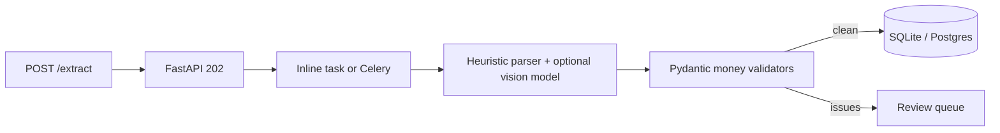

# Document Extraction Engine

Upload a messy invoice. Get structured fields back. If the math does not work, a human review queue gets the exception — the model does not get the last word.

`POST /extract` returns **202 Accepted** immediately. A worker (FastAPI background task locally, Celery + Redis in Docker) runs the extractor so a vision model cannot freeze the API.

## Why this exists

Finance and ops teams do not need another chat UI. They need:

- line items they can post to a ledger
- `subtotal + tax = total` checked in code
- a queue for the documents the model got wrong
- a path that stays on their laptop for sensitive PDFs

## Architecture



## Validation rules

Implemented in `src/schemas/invoice.py`, not in the prompt:

- `line_total ≈ quantity * unit_price`
- `subtotal ≈ sum(line_totals)`
- `total ≈ subtotal + tax`
- vendor and invoice number are required

Tolerance defaults to `$0.01`.

## Quick start

```bash
python -m venv .venv
source .venv/bin/activate
pip install -e ".[dev]"
cp .env.example .env
mkdir -p data
uvicorn api.main:app --reload --app-dir src
```

```bash
curl -s -D - -o /tmp/extract.json \
  -X POST http://127.0.0.1:8000/extract \
  -F "file=@samples/invoice_clean.txt"
# HTTP/1.1 202 Accepted

TASK=$(python -c 'import json; print(json.load(open("/tmp/extract.json"))["task_id"])')
curl -s http://127.0.0.1:8000/status/$TASK
curl -s http://127.0.0.1:8000/review-queue
```

Try `samples/invoice_math_mismatch.txt` to force a review item.

Docker (API + Redis + Celery worker):

```bash
cp .env.example .env
docker compose up --build
```

Optional vision model:

```bash
ollama pull qwen2.5vl:7b
```

Without Ollama the heuristic parser still extracts the sample files. That is intentional: clients can see validation and the review queue before they wire a model.

## API

| Method | Path | Purpose |
| --- | --- | --- |
| `GET` | `/health` | Liveness |
| `POST` | `/extract` | Upload a document, returns `202` + `task_id` |
| `GET` | `/status/{task_id}` | Job status + structured result |
| `GET` | `/review-queue` | Open validation exceptions |
| `POST` | `/review-queue/{id}/resolve` | Mark an exception handled |

## Sample documents

| File | What it proves |
| --- | --- |
| `samples/invoice_clean.txt` | Happy path, no review |
| `samples/invoice_math_mismatch.txt` | `subtotal + tax != total` → review |
| `samples/receipt_missing_vendor.txt` | Missing vendor → review |
| `samples/messy_invoice.txt` | Irregular labels and spacing |
| `samples/multi_item_invoice.txt` | Four line items, math still closes |

## What a client typically asks to customize

- Add W-2 / receipt / bill-of-lading schemas next to `invoice.py`
- Swap SQLite for Postgres and turn on `WORKER_BACKEND=celery`
- Connect the review queue to their existing ops tool
- Keep documents inside their VPC and point `VISION_MODEL` at a local VLM

## Tests

```bash
pytest -q
```

## License

MIT
